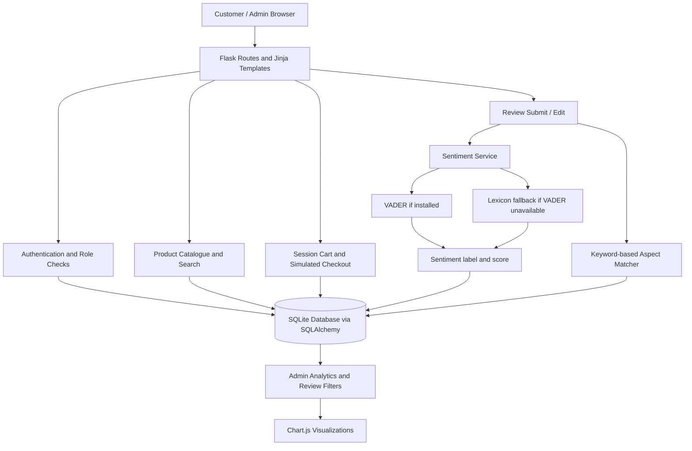
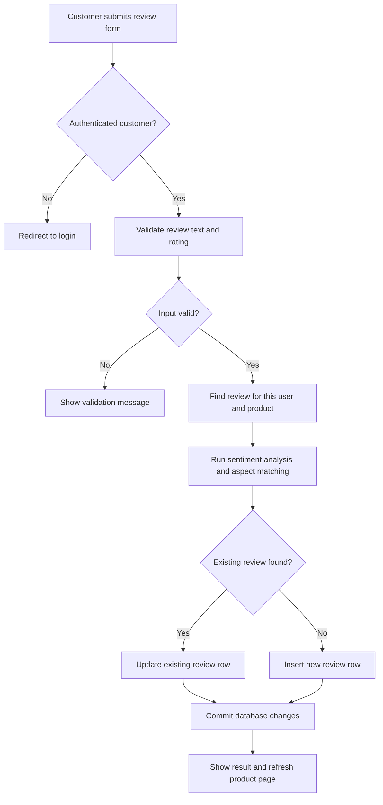

# System Architecture

## Component diagram

## Review submission and edit flow

## Main components

- `app.py`: Flask routes, SQLAlchemy models, authentication, product/cart/order logic, review create-or-update flow, admin authorization, analytics, and seed data.
- `sentiment_service.py`: VADER sentiment classification with a local lexicon fallback, plus keyword-based aspect hints.
- `templates/`: Jinja-based pages for the catalogue, product details, authentication, cart, orders, errors, and admin analytics.
- `static/css/style.css`: application styling.
- `tests/test_sentiment.py`: basic unit tests for positive, negative, and neutral labels and aspect matching.
- `shop.db`: SQLite database created by the application at runtime.

## Data integrity and security notes

- Passwords are stored using Werkzeug password hashing.
- Admin routes use a role-checking decorator.
- A unique database constraint on `(product_id, user_id)` enforces one review per user per product.
- Review submission validates body length and rating values.
- The current project is for local demonstration. Before public deployment, configure a strong secret key, review CSRF protections and form security, and run behind a production WSGI server.
